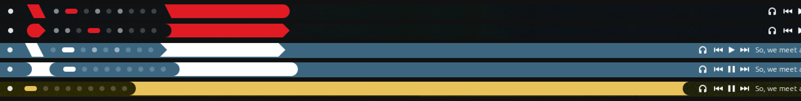
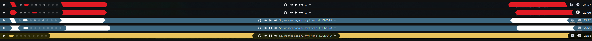

<div align="center">
  

  # kappa.yashi · Cinnamon applets

  A small collection of panel applets for the **Cinnamon** desktop,
  built for ricing — flat, transparent, heavily themeable, and doing
  things the stock applets don't.

  <sub>河童 野史 · underground fanzine · one person, one river, no algorithm</sub>

  
  
</div>

---

## What's inside

| Applet | What it does |
|---|---|
| [Separator](#separator) | Colored spacer with shaped edges, gradients, and a passive "fill the gap" mode. |
| [Launcher](#launcher) | A single panel button: your SVG icon + hover colors, runs any app/command. |
| [Workspace Switcher](#workspace-switcher) | Names / pills / visual, with an accent color on the active workspace. |
| [Media Controls](#media-controls) | MPRIS2 play/pause/next with a configurable hover color. |
| [Window List](#window-list) | Grouped window list, restyled: flat buttons, no underline, custom hover, name-only mode. |
| [Session Manager](#session-manager) | Fullscreen power menu — circular buttons, image/grain background, animations. |

All are English-only, have no third-party dependencies, and allow multiple
instances where it makes sense.

> **Note on compatibility.** These target Cinnamon 4.0–6.2 (Linux Mint and
> other Cinnamon spins). Cinnamon runs on X11.

---

## Install

**Quick (all of them):**

```bash
git clone https://github.com/kappa-yashi/cinnamon-applets.git
cd cinnamon-applets
./install.sh
```

**Just one or a few:**

```bash
./install.sh separator@kappayashi sessionManager@kappayashi
```

**Manual:** copy the applet folder(s) into `~/.local/share/cinnamon/applets/`.

Then reload Cinnamon (`Ctrl+Alt+Esc`, or `Alt+F2` → `r`) and add the applet
from **System Settings → Applets**. Right-click an applet → **Configure** for
its settings.

---

## The applets

### Separator
`separator@kappayashi`

A colored spacer, drawn with Cairo.

- **Independent left/right edge shapes:** flat, rounded (pill), circular notch, pointed, V-notch, slant up/down — mix any combination, with a per-side size.
- **Fill:** solid color or a two-color linear gradient at any angle, with opacity (and a show/hide toggle).
- **Width modes:** a share of its own panel zone, a share of the whole panel, or **fill free space (dynamic)** — a *passive* spring that fills the gap between other applets without ever pushing them.
- No hover highlight; unlimited instances; right-click still opens its menu.

### Launcher
`launcher@kappayashi`

A minimal panel button.

- Custom **SVG icon** (file picker or name/path), transparent background, icon size in px.
- Separate **hover colors** for the icon and/or a background pill.
- Click action: **browse and pick an application** (`.desktop` or executable) or type a command — e.g. to toggle a launcher like ulauncher.

### Workspace Switcher
`workspace-switcher@kappayashi`

- Three display modes: names, indicators (bullets/pills), or a visual representation.
- **Accent color** that tints only the *active* workspace, across all three modes.

### Media Controls
`musiccontrols@kappayashi`

- Previous / play-pause / next for any MPRIS2 player, with track info.
- Transparent background and a **configurable hover color** for the buttons.

### Window List
`grouped-window-list@kappayashi`

A fork of the built-in grouped window list, restyled.

- Master **custom styling** toggle: flat buttons, removes the theme's running-indicator underline.
- Custom **hover background + label colors**.
- Optional **own running indicator** (color, thickness, position).
- **Hide icon** (name-only) mode.

### Session Manager
`sessionManager@kappayashi`

A fullscreen power menu instead of a dropdown — shut down, restart, lock,
suspend, log off, and more.

- Circular action buttons (size / spacing / roundness / hover outline).
- **Background:** flat color + opacity, optional **image** (cover/fit/stretch), and procedural **noise/grain** with several styles (normal / light / dark / overlay / soft / colored / RGB) + opacity and grain size.
- Icons: built-in or **per-action custom SVG**; **global or per-icon colors** (main + hover).
- Sizes auto-clamp to the screen resolution; optional uptime label.
- **Fade in/out** with configurable duration and easing, including real custom `cubic-bezier`.

---

## Screenshots

Real panels, built only with these applets — Separator (shaped edges + passive
fill), Workspace Switcher (pill indicators) and Media Controls:



<details>
<summary>Full-width panels</summary>



</details>

---

## Credits

Some of these started as forks of community applets and were then rewritten.
See [`CREDITS.md`](CREDITS.md) for origins and attribution.

## Disclaimer

These applets are provided **as is**, with no warranty of any kind. You install
and use them **at your own risk**. They change how your panel looks and
behaves, and the Session Manager can shut down, restart, suspend or log out
your system — always save your work first.

This is a personal, non-commercial project. There is **no obligation** to
provide updates, bug fixes, compatibility with future Cinnamon versions, or
support of any kind. Issues and pull requests may be looked at when time
allows, or not at all.

The author is not liable for any damage, data loss or other problems that
result from using this software. See sections 15–16 of the
[GPL-3.0 license](LICENSE) for the full warranty disclaimer and limitation
of liability.

## License

[GPL-3.0](LICENSE).

## Supporting the project

If these are useful to you, you can support the work through the
kappa.yashi site: **[www.kappayashi.page](https://www.kappayashi.page)**.
